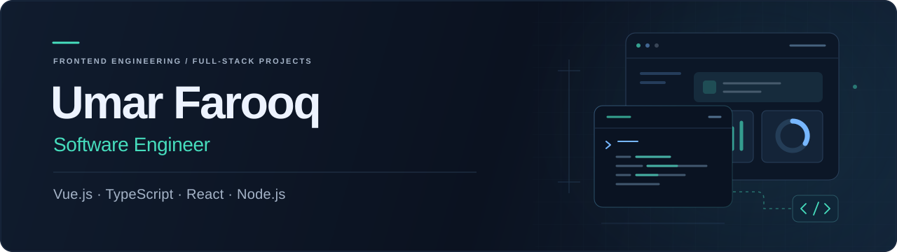

  
  <a href="https://github.com/umarfarooq0011?tab=repositories">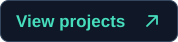</a>
  

I'm **Umar Farooq**, a software engineer building business web applications with **Vue.js, TypeScript, React, and Node.js**. I focus on reusable interfaces, API integration, state management, and the workflows that make software useful.

Currently a **Software Engineer at RigRex**, with hands-on experience across **MERN and MEVN** applications.

## Professional experience

**Software Engineer · RigRex**  
September 2025–present · Remote

**Frontend Developer · Fiverr**  
July 2024–January 2025 · Remote

### automotiveDMS

Approximately **one year** contributing to a dealership management platform, with **1,000+ authored commits** in its GitLab frontend repository.

- **Business workflows:** vehicle inventory, sales, CRM, communication, documents, and dashboards.
- **Frontend engineering:** reusable Vue 3 components and composables, TypeScript, Vuetify, Pinia, and API integration.
- **Product quality:** responsive layouts, multilingual interfaces, role-based UI behavior, and automated tests.

My professional work is hosted on [GitLab](https://gitlab.com/automoordms/admin-frontend), where repository access is restricted. The projects below are available to explore on GitHub.

## Selected projects

  <a href="https://github.com/umarfarooq0011/BlogwebfullApp">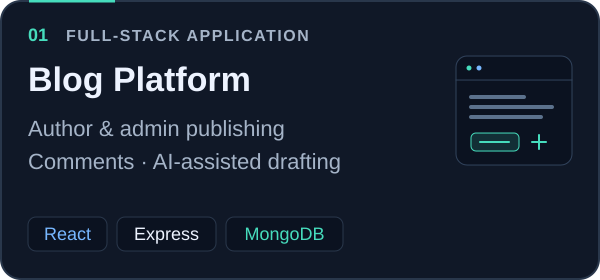</a>
  <a href="https://github.com/umarfarooq0011/Vue_Ecommere_Dashboard">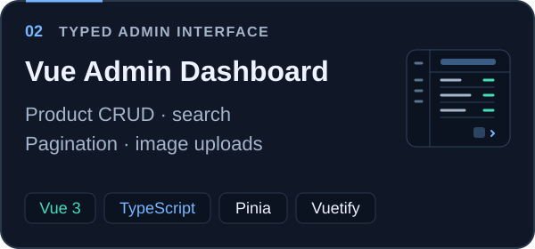</a>

  <a href="https://github.com/umarfarooq0011/Ecommerce_VUE">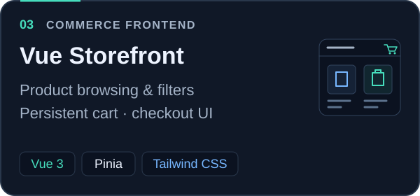</a>
  <a href="https://github.com/umarfarooq0011/Formbuilder-backend">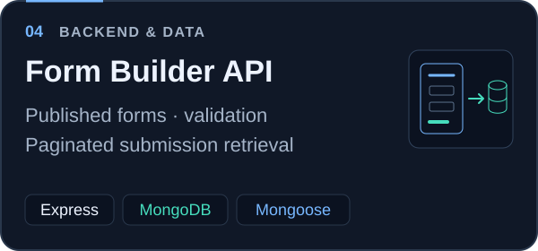</a>

Also built [**SaveSpree — Personal Finance Tracker**](https://github.com/umarfarooq0011/Financial-tracker-app): income and expense tracking, budgets, charts, date filters, and PDF export with JavaScript and localStorage.

## Skills & tools

**Frontend**

  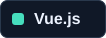
  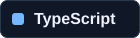
  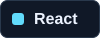
  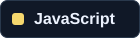
  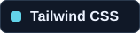
  

**State & data**

  
  
  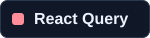
  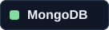
  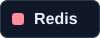

**Backend & quality**

  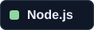
  
  
  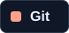
  
  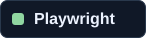
  

**Also work with:** HTML, CSS, REST APIs, Axios, Vue Router, React Router, Mongoose, localization, GitHub, and GitLab.

---

Interested in collaborating? [**Let's connect on LinkedIn →**](https://www.linkedin.com/in/umer-farooq-96b70430a/).
