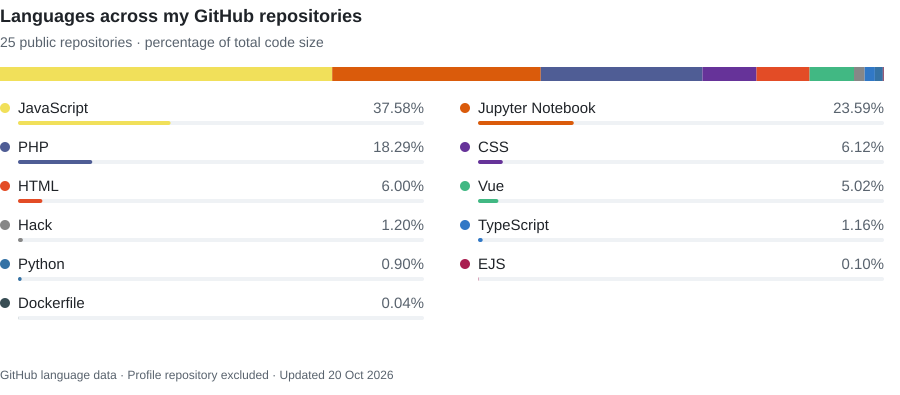
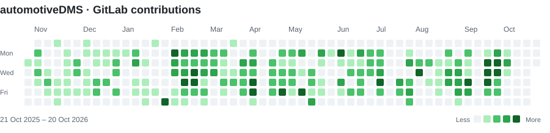

# Umar Farooq

### Software Engineer | Frontend & Full-Stack Development

[LinkedIn](https://www.linkedin.com/in/umer-farooq-96b70430a/) · [GitHub projects](https://github.com/umarfarooq0011?tab=repositories) · [GitLab](https://gitlab.com/Umarfarooq1122) · [automotiveDMS](https://gitlab.com/automoordms/admin-frontend)

Software Engineer at **RigRex**, specializing in frontend and full-stack web development with **Vue.js, TypeScript, React, Node.js, Express, and MongoDB**. My experience includes dealership management systems, reusable frontend architecture, state management, REST API integration, and automated testing.

## Languages & technologies

  &nbsp;
  &nbsp;
  &nbsp;
  &nbsp;
  &nbsp;
  &nbsp;
  &nbsp;
  &nbsp;
  &nbsp;
  &nbsp;
  &nbsp;
  &nbsp;
  &nbsp;
  &nbsp;
  &nbsp;
  &nbsp;
  &nbsp;
  

**State management:** Pinia, Redux, React Query  
**API & data:** REST APIs, Axios, MongoDB, Mongoose, Redis  
**Development & testing:** Git, Docker, Vite, Vitest, Playwright

<!-- profile-stats:languages:start -->
<picture>
  <source media="(max-width: 600px) and (prefers-color-scheme: dark)" srcset="./assets/statistics/repository-languages-mobile-dark.svg" />
  <source media="(max-width: 600px)" srcset="./assets/statistics/repository-languages-mobile-light.svg" />
  <source media="(prefers-color-scheme: dark)" srcset="./assets/statistics/repository-languages-dark.svg" />
  
</picture>

Percentages reflect code size across all my public non-fork repositories, excluding this profile repository. Frameworks such as React and Express are represented through their source languages. Updated 26 October 2026.
<!-- profile-stats:languages:end -->

## Professional experience

**Software Engineer · RigRex**  
September 2025–present

Contributing to **automotiveDMS**, a dealership management platform:

- Develop interfaces for vehicle inventory, sales, CRM, communication, documents, and reporting.
- Build reusable Vue 3 components and composables with TypeScript, Vuetify, and Pinia.
- Integrate REST APIs and maintain responsive, multilingual interfaces with role-aware UI behavior and automated tests.

**Currently building [Foldercutting Dashboard](https://github.com/RigRex/foldercutting-fe)** — a Vue 3 and TypeScript dashboard with reusable components, Pinia state management, and role-aware navigation. In development at RigRex; repository access is required.

<!-- profile-stats:gitlab:start -->
**1,031 authored non-merge commits across 179 active days** during the last 365 days.

<picture>
  <source media="(prefers-color-scheme: dark)" srcset="./assets/statistics/automotivedms-contributions-dark.svg" />
  
</picture>

GitLab activity · Author dates on the default branch, dev · 27 October 2025–26 October 2026 · Refreshed automatically; last update 26 October 2026.
<!-- profile-stats:gitlab:end -->

**Frontend Developer · Fiverr**  
July 2024–January 2025

## Selected projects

- [**Blog Platform**](https://github.com/umarfarooq0011/BlogwebfullApp) — React, Express, and MongoDB application with author and admin publishing, comments, and AI-assisted drafting.
- [**Vue Admin Dashboard**](https://github.com/umarfarooq0011/Vue_Ecommere_Dashboard) — Vue 3, TypeScript, Pinia, and Vuetify dashboard for product management, search, pagination, and image uploads.
- [**Vue Storefront**](https://github.com/umarfarooq0011/Ecommerce_VUE) — Vue 3 and Pinia storefront with product filtering, a persistent cart, and checkout screens.
- [**Form Builder API**](https://github.com/umarfarooq0011/Formbuilder-backend) — Express and MongoDB API for form publishing, submission validation, and paginated retrieval.
- [**SaveSpree**](https://github.com/umarfarooq0011/Financial-tracker-app) — JavaScript finance tracker with income and expense management, budgets, charts, date filtering, and PDF export.

<!-- profile-stats:github:start -->
## GitHub activity

<picture>
  <source media="(prefers-color-scheme: dark)" srcset="./assets/statistics/github-contributions-dark.svg" />
  
</picture>

GitHub activity refreshes automatically and is separate from GitLab activity. Updated 26 October 2026.
<!-- profile-stats:github:end -->

---

[Connect with me on LinkedIn](https://www.linkedin.com/in/umer-farooq-96b70430a/)
