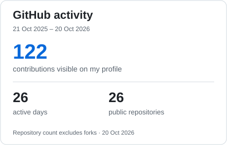

  
  
  

I'm **Umar Farooq**, a **Software Engineer at RigRex** specializing in frontend and full-stack web development. I develop and maintain applications using **Vue.js, TypeScript, React, Node.js, Express, and MongoDB**.

My experience includes dealership management systems, reusable frontend architecture, state management, REST API integration, and automated testing.

## Professional experience

### Software Engineer · RigRex

**September 2025–present**

Contributing to **automotiveDMS**, a dealership management platform, with **1,000+ authored commits** to its frontend codebase.

- Develop and maintain interfaces for vehicle inventory, sales, CRM, communication, documents, and reporting.
- Implement reusable Vue 3 components and composables with TypeScript, Vuetify, and Pinia.
- Integrate REST APIs and maintain responsive, multilingual interfaces with role-aware UI behavior and automated tests.

<a href="https://gitlab.com/automoordms/admin-frontend">
  <picture>
    <source media="(prefers-color-scheme: dark)" srcset="./assets/statistics/automotivedms-contributions-dark.svg" />
    
  </picture>
</a>

Professional contributions on GitLab · Verified 20 October 2026 · Repository access required

**Earlier experience:** Frontend Developer · Fiverr · July 2024–January 2025

## Languages & technologies

  &nbsp;
  &nbsp;
  &nbsp;
  &nbsp;
  &nbsp;
  &nbsp;
  &nbsp;
  &nbsp;
  &nbsp;
  &nbsp;
  &nbsp;
  &nbsp;
  &nbsp;
  &nbsp;
  &nbsp;
  &nbsp;
  &nbsp;
  

**State management:** Pinia, Redux, React Query  
**API & data:** REST APIs, Axios, MongoDB, Mongoose, Redis  
**Engineering tools:** Git, Docker, Vite, Vitest, Playwright

## Selected projects

  
  

  
  

[**SaveSpree — Personal Finance Tracker**](https://github.com/umarfarooq0011/Financial-tracker-app) · JavaScript application for income and expense tracking, budgets, charts, date filtering, and PDF export.

## GitHub statistics

<picture>
  <source media="(prefers-color-scheme: dark)" srcset="./assets/statistics/github-activity-dark.svg" />
  
</picture>
<picture>
  <source media="(prefers-color-scheme: dark)" srcset="./assets/statistics/repository-languages-dark.svg" />
  
</picture>

About these statistics

Statistics were verified on **20 October 2026**.

- **automotiveDMS:** 1,032 authored non-merge commits reachable from the GitLab repository's default branch, `dev`, verified through the GitLab API. The calendar uses author dates from 21 October 2025 through 20 October 2026.
- **GitHub:** Contributions already visible on my public GitHub profile for the same period. Public repository totals exclude forks.
- **Languages:** Code-size distribution across my public non-fork repositories, excluding this profile repository. This represents repository contents, not skill proficiency.

The GitLab calendar is displayed separately from GitHub's native contribution graph. These graphics are dated snapshots.

---

[**Connect with me on LinkedIn**](https://www.linkedin.com/in/umer-farooq-96b70430a/)
